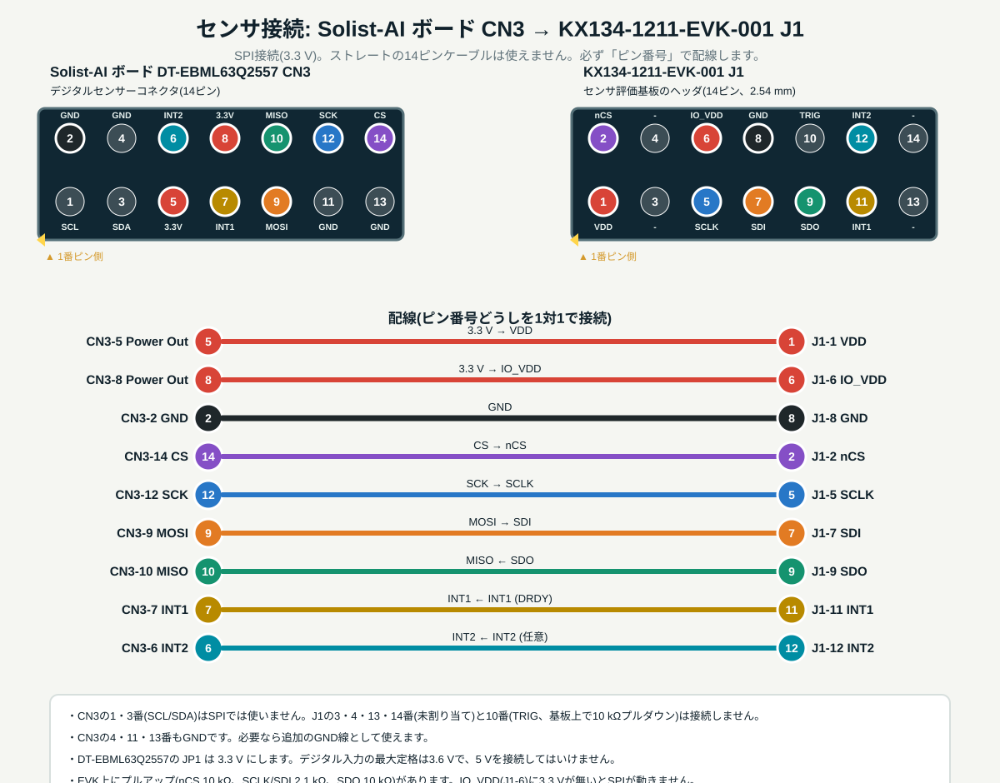
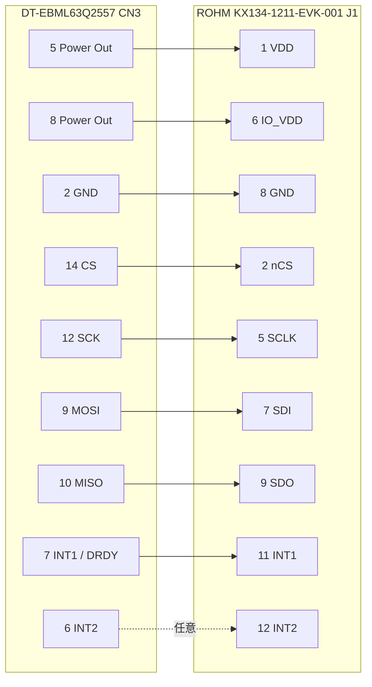
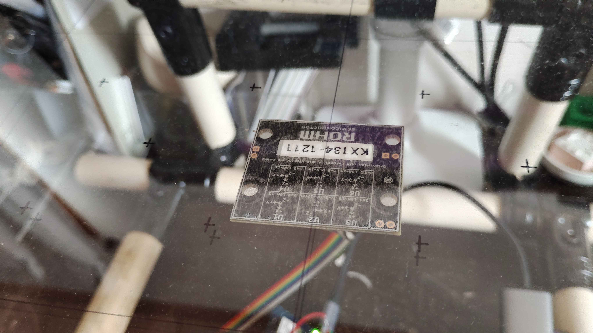
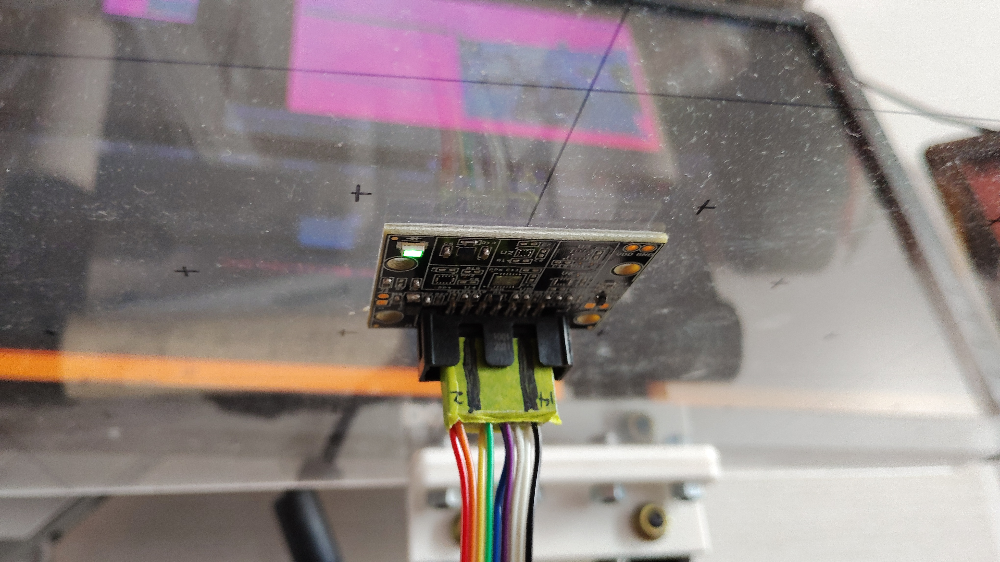
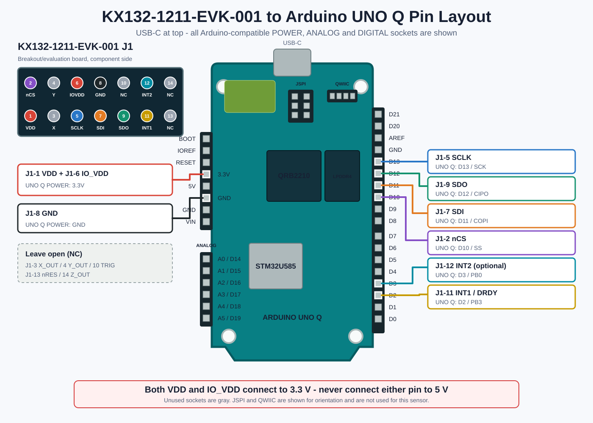

# KX134-1211-EVK-001 変換配線

対象は、DT-EBML63Q2557 のデジタルセンサーコネクタ `CN3` と、
ROHM `KX134-1211-EVK-001` の2×7ピンコネクタ `J1` です。

両方とも14ピンですが、ピンごとの信号配置は異なります。
**ストレートの14ピンリボンケーブルでは接続しないでください。**

## 安全上の注意

- USBケーブルとセンサーを外した状態で変換ケーブルを作る。
- DT-EBML63Q2557 の `JP1` は必ず **3.3 V** に設定する。
- DT-EBML63Q2557 のデジタル入力最大定格は3.6 Vであり、5 V信号を接続しない。
- 基板上の三角印、角パッドまたはシルク表示で1番ピンを確認する。
- 電源投入前に、VDD、IO_VDD、GNDおよび短絡の有無をテスターで確認する。
- 本書の左右表示ではなく、必ず**ピン番号**を基準に配線する。

## コネクタ比較

ピン番号を正面から確認した概念図です。実物の向きはコネクタおよびケーブルの
キー方向によって変わるため、1番ピン表示を優先します。

```text
DT-EBML63Q2557 CN3                 ROHM KX134-1211-EVK-001 J1

  1 SCL       2 GND                  1 VDD       2 nCS
  3 SDA       4 GND                  3 NC        4 NC
  5 POWER     6 INT2                 5 SCLK      6 IO_VDD
  7 INT1      8 POWER                7 SDI       8 GND
  9 MOSI     10 MISO                 9 SDO      10 TRIG
 11 GND      12 SCK                 11 INT1     12 INT2
 13 GND      14 CS                  13 NC       14 NC
```

## 接続の模式図



同じ図を公開ページの[ハードウェア](../web/pages/hardware.html)に載せている。

## SPI変換配線



| DT CN3 | 信号 | ROHM J1 | 信号 | 必須 |
|---:|---|---:|---|:---:|
| 5 | Power Out (3.3 V) | 1 | VDD | Yes |
| 8 | Power Out (3.3 V) | 6 | IO_VDD | Yes |
| 2 | GND | 8 | GND | Yes |
| 14 | CS | 2 | nCS | Yes |
| 12 | SCK | 5 | SCLK/SCL | Yes |
| 9 | MOSI | 7 | SDI/SDA | Yes |
| 10 | MISO | 9 | SDO/ADDR | Yes |
| 7 | INT1 | 11 | INT1 | DRDY使用時 |
| 6 | INT2 | 12 | INT2 | 任意 |

CN3の4、11、13番はすべてGNDです。必要に応じて追加のGND線として利用できます。
J1の10番 `TRIG` は評価基板上でプルダウンされるため、外部トリガを使わない場合は
未接続にします。J1の3、4、13、14番も接続しません。CN3の1番 `SCL` と3番 `SDA` は
SPI動作では使用しません。

## 電源投入前チェック

1. `JP1` が3.3 V側であることを確認する。
2. センサーを外した状態で、CN3側Power Outが3.3 Vであることを測る。
3. 電源を切り、J1-1とJ1-6がPower Outへ、J1-8がGNDへ導通することを確認する。
4. VDD/IO_VDDとGNDが短絡していないことを確認する。
5. 最初は電流制限可能な電源またはUSB電流計を使う。
6. 診断ファームウェアで `WHO_AM_I` が `0x46` になることを確認する。

## 根拠資料

- [DT-EBML63Q2557 ハードウェアユーザーズマニュアル](https://www.datatecno.co.jp/datatecno_core/content/uploads/2025/06/DT-EBML63Q2557_hardware_users_manual_Rev.20250527.pdf)
  - 5.11 デジタルセンサーインターフェース
  - 6.2 デジタルセンサー入力信号の最大定格3.6 V
  - 7.1 CN3ピンアサイン
- [KX134-1211-EVK-001 使い方資料](https://fscdn.rohm.com/kionix/jp/document/kx134-1211-evk-001_ug-j.pdf)
- [ROHM EVK Hardware User's Guide](https://fscdn.rohm.com/jp/products/databook/applinote/ic/sensor/rohm-evk-hw_ug-j.pdf)
- [ROHM 14ピンJ1の信号配置資料](https://fscdn.rohm.com/en/products/databook/applinote/ic/sensor/kx134acr-evk-001_ug-e.pdf)

## 実機での確認結果(派生プロジェクト acrylic_pan_uno_q)

元のセンサボード(DT-EBML63Q2557 付属のKX134ブレークアウト)は故障したため、
派生プロジェクト [acrylic_pan_uno_q](https://github.com/airpocket-soundman/acrylic_pan_uno_q)
では、ROHM製の **KX134-1211-EVK-001**(別基板・同じKX134-1211)に交換して動作を確認した。
センサICは同じROHM製だが、**ボード上のコネクタのIO並びが元のCN3と異なる**ため、
上記の変換配線が必要になる。

| 上面(ROHMロゴ、KX134-1211表記) | 下面(14ピンJ1、IDCケーブル接続) |
|---|---|
|  |  |

確認した内容(Arduino UNO Q + STM32U585、3.3 V SPI):

- 上の「SPI変換配線」のJ1ピン配置で `WHO_AM_I = 0x46` を読み出せた。
- 25.6 kHz・±32 g で 127,992〜128,000 サンプルを連続取得し、取りこぼし(missed)は0だった。
- J1の1/6がVDD/IO_VDD、2がnCS、5がSCLK、7がSDI、9がSDO、11がINT1、12がINT2、8がGNDである。

今回使った基板のJ1(2列7ピン、2.54 mmピッチ)の全ピン並びは次のとおり。
部品面を上から見て、センサを上・J1を下に置くと、センサ側の列が偶数、基板端側の列が奇数になり、
左端が1/2、右端が13/14になる。

```text
              KX134-1211
                  ^
 J1   2   4   6   8  10  12  14   (センサ側)
      1   3   5   7   9  11  13   (基板端側)
```

| J1 | 信号 | 備考 | J1 | 信号 | 備考 |
|---:|---|---|---:|---|---|
| 1 | VDD | 3.3 V | 2 | nCS | SPIチップセレクト |
| 3 | - | 未割り当て | 4 | - | 未割り当て |
| 5 | SCLK / SCL | SPIクロック | 6 | IO_VDD | 3.3 V |
| 7 | SDI / SDA | MOSI | 8 | GND | GND |
| 9 | SDO / ADDR | MISO | 10 | SYNC / TRIG | 未接続 |
| 11 | INT1 | DRDY | 12 | INT2 | 任意 |
| 13 | - | 未割り当て | 14 | - | 未割り当て |

### J1のピンの物理配置とUNO Qへの結線図

J1を部品面から見た物理配置は、下図の左上のとおり。**上段が偶数(2〜14)、下段が奇数(1〜13)**で、
左端が1/2、右端が13/14になる。色はUNO Q側への結線の色と対応する。



> 図のタイトルは派生側の資料に合わせて`KX132-1211-EVK-001`となっているが、
> J1のピン配置はKX134-1211-EVK-001と同じである。

**物理配置の根拠:** ROHMの使い方資料
[KX134-1211-EVK-001 Manual](https://fscdn.rohm.com/kionix/en/document/kx134-1211-evk-001_ug-e.pdf)
(No. 63UG087E Rev.002)のボード写真(部品面)で、J1が基板下辺の2×7ピン箱型ヘッダであり、
シルクが上段の左端`2`・右端`14`、下段の左端`1`(▼印)・右端`13`であることを確認した。
この資料にはJ1のピンごとの信号表は載っていない(使い方、写真、部品表のみ)。信号の割り当ては
下記「根拠資料」のROHM資料と、実機動作(`WHO_AM_I = 0x46`)で確認したものである。

基板上のその他の特徴(下面の写真で確認):

- J1は基板の長辺の一方に並ぶ2×7ピンのヘッダで、角形ソケットとフラットケーブルが基板の外側へ出る。
- 部品面側から見てJ1側を手前にすると、ケーブル端のテープ書き込みは左が`2`、右が`14`である。
- J1と反対側の長辺に`VDD` `GND`の電源パッド、左上に緑色の電源LEDがある。
- 反対面(ROHMロゴ面、パネルに接する側)にはセンサのパターンがU1〜U6の3×2配置で印刷されており、
  KX134-1211を実装して使う。四隅に取付穴がある。

UNO Q側の接続は次のとおり(元プロジェクトのDT-EBML63Q2557 CN3側に読み替えて使う)。

| KX134-1211-EVK-001 J1 | 信号 | UNO Q |
|---:|---|---|
| 1, 6 | VDD, IO_VDD | 3.3 V |
| 8 | GND | GND |
| 2 | nCS | D10 / SS |
| 7 | SDI | D11 / COPI |
| 9 | SDO | D12 / CIPO |
| 5 | SCLK | D13 / SCK |
| 11 | INT1 / DRDY | D2(診断用) |
| 12 | INT2 | D3(任意) |

詳細な配線図・電源投入前チェックは派生側の
[uno-q-sensor-wiring.md](https://github.com/airpocket-soundman/acrylic_pan_uno_q/blob/main/docs/uno-q-sensor-wiring.md)
と
[kx132-1211-evk-wiring.md](https://github.com/airpocket-soundman/acrylic_pan_uno_q/blob/main/docs/kx132-1211-evk-wiring.md)
を参照する。

> 注意: 購入品によって基板リビジョンが異なる可能性があるため、電源投入前に
> 1番ピン表示とVDD/GNDの導通を実物で確認すること。
